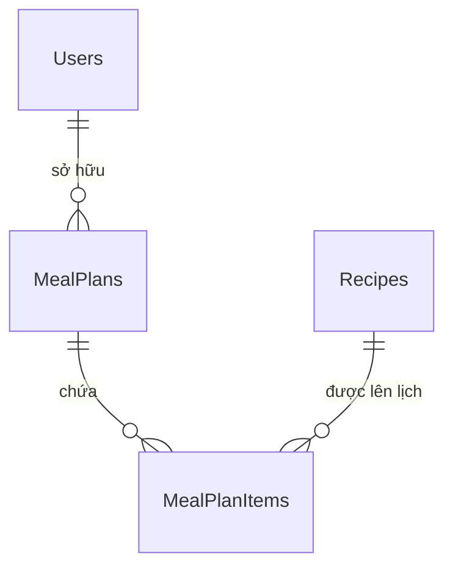

# Thiết kế cơ sở dữ liệu SmartCook

## Trạng thái xác minh tại bàn giao

Schema nền trong `schema.sql` gồm 10 bảng, 12 FK, 7 UNIQUE, 32 CHECK và 8 DEFAULT. Sau thay đổi Meal Planner, migration `001_weekly_meal_planner.sql` đã được áp dụng ngày27/10/2026; SmartCookDB hiện có **12 bảng**, gồm thêm MealPlans và MealPlanItems. Hợp đồng đầy đủ có 12 PK, 9 UNIQUE, 15 FK, 39 CHECK, 13 DEFAULT và 10 index nonclustered khai báo riêng (31 index khi tính PK/UNIQUE).

Các phần bảng1–10 bên dưới vẫn mô tả schema nền và dữ liệu Pantry được giữ lại. Hai bảng mới được mô tả ở mục Meal Planner và [MEAL_PLANNER_DATABASE.md](MEAL_PLANNER_DATABASE.md). Kết quả Bước11–12 là lịch sử; kết quả của migration/chức năng mới nằm tại [MEAL_PLANNER_VERIFICATION.md](MEAL_PLANNER_VERIFICATION.md).

Sơ đồ ER nền nằm tại [ERD.md](ERD.md); quan hệ Meal Planner bổ sung ở cuối tài liệu này. Hướng dẫn cài đặt/run script tại [INSTALLATION.md](INSTALLATION.md). Database không có Admin mặc định.

`SmartCookDB` lưu công thức, nguyên liệu và dữ liệu cá nhân hóa bằng **Microsoft SQL Server**. Các phần bảng nền giữ thiết kế của Bước 2; API nghiệp vụ, xác thực, quản trị, gợi ý và Meal Planner đã được bổ sung ở những giai đoạn sau. Express vẫn giữ endpoint kiểm tra trạng thái độc lập SQL Server để có thể khởi động và báo health khi database chưa kết nối.

- Script cấu trúc nền: [database/schema.sql](../database/schema.sql); sau đó chạy [migration Meal Planner](../database/migrations/001_weekly_meal_planner.sql) cho máy mới.
- Dữ liệu mẫu: [database/seed.sql](../database/seed.sql).
- Cách cấu hình, chạy và kiểm tra: [database/README.md](../database/README.md).
- Sơ đồ schema nền 10 bảng: [ERD.md](ERD.md); quan hệ hai bảng mới được bổ sung ở mục dưới.

## Quy ước chung

| Nội dung | Quy ước |
| --- | --- |
| Database/schema | `SmartCookDB`, các bảng trong `dbo`. |
| Khóa chính | `INT IDENTITY(1,1)`; riêng `RecipeIngredients` dùng khóa kép `(RecipeID, IngredientID)`. Không giả định ID seed cố định. |
| Văn bản | `NVARCHAR` và literal `N'...'` để giữ tiếng Việt. |
| Collation | Database mới dùng `Vietnamese_100_CI_AS`; database có sẵn được giữ nguyên collation. Mọi cột `NVARCHAR` trong schema khai báo riêng `Vietnamese_100_CI_AS`, trừ `Users.Email` dùng `Latin1_General_100_CI_AS`. |
| Thời gian hệ thống | `DATETIME2(0)`, lưu UTC; mặc định `SYSUTCDATETIME()`. UI sẽ chuyển sang múi giờ người dùng ở giai đoạn sau. |
| Thời lượng | `PrepTime`, `CookTime` tính bằng phút. |
| Định lượng | `DECIMAL(12,2)`, đơn vị lưu riêng bằng `NVARCHAR(30)`. |
| Khóa ngoại | Tất cả dùng `ON DELETE NO ACTION`, `ON UPDATE NO ACTION`. |
| Giá trị tùy chọn | Dùng `NULL` khi chưa biết/chưa có; các trường văn bản nếu có giá trị không nhận chuỗi rỗng hoặc chỉ có dấu cách. |

`CI_AS` không đồng nghĩa tìm kiếm bỏ dấu: `trứng` và `trung` không được coi là cùng tên. Cần thiết kế cách tìm kiếm phù hợp ở bước xây chức năng tìm món. Tên món không duy nhất để cho phép những biến thể cùng tên; mỗi công thức được nhận diện bởi `RecipeID`.

Ở máy đã kiểm tra, `SmartCookDB` tồn tại với collation `SQL_Latin1_General_CP1_CI_AS`; script giữ nguyên giá trị này. Collation tường minh trên cột giúp đối chiếu văn bản nhất quán mà không phải thay đổi database có sẵn. Những truy vấn bổ sung có bảng tạm hoặc biến bảng cần dùng collation tương thích khi JOIN văn bản.

## Từ điển dữ liệu

Trong các bảng dưới đây, “Không” ở cột NULL có nghĩa là `NOT NULL`; dấu `—` nghĩa là không có giá trị mặc định. Các khóa `IDENTITY` do SQL Server cấp tự động.

### 1. Users — tài khoản

| Cột | Kiểu | NULL | Mặc định / ràng buộc |
| --- | --- | --- | --- |
| `UserID` | `INT IDENTITY(1,1)` | Không | PK. |
| `FullName` | `NVARCHAR(150)` | Không | Tên hiển thị, không trắng. |
| `Email` | `NVARCHAR(255)` | Không | UNIQUE, không phân biệt hoa/thường; CHECK dạng cơ bản có `@`, dấu chấm và không có dấu cách. |
| `PasswordHash` | `NVARCHAR(255)` | Không | Chỉ lưu hash; không trắng. |
| `Phone` | `NVARCHAR(20)` | Có | — |
| `Avatar` | `NVARCHAR(500)` | Có | Đường dẫn ảnh, —. |
| `Role` | `NVARCHAR(20)` | Không | `N'User'`; CHECK đúng chuỗi `User` hoặc `Admin`, phân biệt hoa/thường. |
| `CreatedAt` | `DATETIME2(0)` | Không | `SYSUTCDATETIME()`. |

Backend ở giai đoạn xác thực phải chuẩn hóa email, kiểm tra định dạng, băm mật khẩu bằng bcrypt và kiểm soát quyền thay đổi `Role`. Cột `PasswordHash` không tự băm hoặc tự chứng minh một chuỗi là hash hợp lệ. Seed không tạo tài khoản, mật khẩu hoặc JWT secret.

### 2. Categories — danh mục món ăn

| Cột | Kiểu | NULL | Mặc định / ràng buộc |
| --- | --- | --- | --- |
| `CategoryID` | `INT IDENTITY(1,1)` | Không | PK. |
| `CategoryName` | `NVARCHAR(150)` | Không | UNIQUE; không trắng. |
| `Description` | `NVARCHAR(500)` | Có | — |
| `ImageUrl` | `NVARCHAR(500)` | Có | — |

Mỗi món thuộc một danh mục; danh mục có thể chưa chứa món nào.

### 3. Recipes — công thức món ăn

| Cột | Kiểu | NULL | Mặc định / ràng buộc |
| --- | --- | --- | --- |
| `RecipeID` | `INT IDENTITY(1,1)` | Không | PK. |
| `CategoryID` | `INT` | Không | FK → `Categories.CategoryID`. |
| `RecipeName` | `NVARCHAR(200)` | Không | Không trắng; không UNIQUE. |
| `Description` | `NVARCHAR(MAX)` | Có | — |
| `ImageUrl` | `NVARCHAR(500)` | Có | — |
| `PrepTime` | `INT` | Không | `>= 0`, phút chuẩn bị. |
| `CookTime` | `INT` | Không | `>= 0`, phút chế biến. |
| `Servings` | `INT` | Không | `> 0`, số khẩu phần gốc. |
| `Difficulty` | `NVARCHAR(30)` | Không | CHECK đúng chuỗi `Dễ`, `Trung bình` hoặc `Khó`, phân biệt hoa/thường. |
| `CreatedBy` | `INT` | Có | FK → `Users.UserID`; seed dùng `NULL`. |
| `CreatedAt` | `DATETIME2(0)` | Không | `SYSUTCDATETIME()`. |
| `UpdatedAt` | `DATETIME2(0)` | Không | `SYSUTCDATETIME()`; `>= CreatedAt`. |

Tổng `PrepTime + CookTime` phải lớn hơn 0. `UpdatedAt` chỉ có mặc định khi chèn; không có trigger tự cập nhật. Khi sửa công thức, tầng ứng dụng phải đặt `UpdatedAt = SYSUTCDATETIME()` trong cùng thao tác lưu.

### 4. Ingredients — nguyên liệu chuẩn

| Cột | Kiểu | NULL | Mặc định / ràng buộc |
| --- | --- | --- | --- |
| `IngredientID` | `INT IDENTITY(1,1)` | Không | PK. |
| `IngredientName` | `NVARCHAR(150)` | Không | UNIQUE; không trắng. |
| `IngredientCategory` | `NVARCHAR(100)` | Không | Nhóm nguyên liệu, không trắng. |
| `DefaultUnit` | `NVARCHAR(30)` | Không | Đơn vị thường dùng, không trắng. |
| `ImageUrl` | `NVARCHAR(500)` | Có | — |

`IngredientCategory` là nhãn nhóm nguyên liệu, không phải FK đến danh mục món ăn. `DefaultUnit` hỗ trợ nhập liệu; công thức vẫn lưu đơn vị thực tế trong `RecipeIngredients.Unit`.

### 5. RecipeIngredients — thành phần và định lượng

| Cột | Kiểu | NULL | Mặc định / ràng buộc |
| --- | --- | --- | --- |
| `RecipeID` | `INT` | Không | PK kép; FK → `Recipes.RecipeID`. |
| `IngredientID` | `INT` | Không | PK kép; FK → `Ingredients.IngredientID`. |
| `Quantity` | `DECIMAL(12,2)` | Không | `> 0`. |
| `Unit` | `NVARCHAR(30)` | Không | Không trắng. |
| `IsRequired` | `BIT` | Không | `1`; `0` đánh dấu thành phần tùy chọn. |
| `Notes` | `NVARCHAR(255)` | Có | Hướng dẫn sơ chế, thay thế hoặc cách dùng, —. |

Khóa `(RecipeID, IngredientID)` ngăn lặp một nguyên liệu trong cùng công thức. Nếu một nguyên liệu dùng ở nhiều bước, lưu tổng lượng tại đây và giải thích cách chia trong `Notes`/bước nấu. Các liên kết dùng ID nguyên liệu chuẩn để hỗ trợ đối chiếu nguyên liệu hiện có ở giai đoạn sau.

### 6. CookingSteps — hướng dẫn nấu

| Cột | Kiểu | NULL | Mặc định / ràng buộc |
| --- | --- | --- | --- |
| `StepID` | `INT IDENTITY(1,1)` | Không | PK. |
| `RecipeID` | `INT` | Không | FK → `Recipes.RecipeID`. |
| `StepNumber` | `INT` | Không | `> 0`; UNIQUE cùng `RecipeID`. |
| `Instruction` | `NVARCHAR(MAX)` | Không | Nội dung bước, không trắng. |
| `ImageUrl` | `NVARCHAR(500)` | Có | — |

Đọc các bước theo `ORDER BY StepNumber`. SQL bảo vệ tính duy nhất và số bước dương; tính liên tục `1, 2, 3, ...` cần được kiểm tra khi lưu công thức. Seed có đúng 4 bước cho mỗi món, đáp ứng yêu cầu 3–6 bước; schema không giới hạn số bước tối đa của một công thức tương lai.

### 7. Favorites — món yêu thích

| Cột | Kiểu | NULL | Mặc định / ràng buộc |
| --- | --- | --- | --- |
| `FavoriteID` | `INT IDENTITY(1,1)` | Không | PK. |
| `UserID` | `INT` | Không | FK → `Users.UserID`; UNIQUE cùng `RecipeID`. |
| `RecipeID` | `INT` | Không | FK → `Recipes.RecipeID`. |
| `CreatedAt` | `DATETIME2(0)` | Không | `SYSUTCDATETIME()`. |

Một tài khoản chỉ lưu một món một lần.

### 8. Reviews — đánh giá

| Cột | Kiểu | NULL | Mặc định / ràng buộc |
| --- | --- | --- | --- |
| `ReviewID` | `INT IDENTITY(1,1)` | Không | PK. |
| `UserID` | `INT` | Không | FK → `Users.UserID`; UNIQUE cùng `RecipeID`. |
| `RecipeID` | `INT` | Không | FK → `Recipes.RecipeID`. |
| `Rating` | `INT` | Không | CHECK từ `1` đến `5`. |
| `Comment` | `NVARCHAR(MAX)` | Có | Nội dung nhận xét, —. |
| `CreatedAt` | `DATETIME2(0)` | Không | `SYSUTCDATETIME()`. |

Mỗi người có tối đa một đánh giá cho mỗi món. Sửa đánh giá sẽ cập nhật dòng cũ; schema hiện chưa có lịch sử chỉnh sửa hoặc cột kiểm duyệt. Điểm trung bình được tính từ dữ liệu đánh giá khi cần, chưa lưu lặp trong `Recipes`.

### 9. UserIngredients — nguyên liệu của người dùng

| Cột | Kiểu | NULL | Mặc định / ràng buộc |
| --- | --- | --- | --- |
| `UserIngredientID` | `INT IDENTITY(1,1)` | Không | PK. |
| `UserID` | `INT` | Không | FK → `Users.UserID`; UNIQUE cùng `IngredientID`. |
| `IngredientID` | `INT` | Không | FK → `Ingredients.IngredientID`. |
| `Quantity` | `DECIMAL(12,2)` | Có | `NULL` nếu chưa biết lượng; nếu có phải `> 0`. |
| `Unit` | `NVARCHAR(30)` | Có | Nếu có lượng thì bắt buộc có đơn vị; đơn vị có giá trị không được trắng. |
| `ExpiryDate` | `DATE` | Có | `NULL` nếu chưa biết hạn dùng. |

Một dòng biểu diễn tổng nguyên liệu người dùng đang có; chưa hỗ trợ nhiều lô, nhiều đơn vị hoặc nhiều hạn dùng cho cùng cặp `(UserID, IngredientID)`. Khi hết nguyên liệu, luồng ứng dụng sau này xóa dòng thay vì lưu `Quantity = 0`. Không cấm ngày hết hạn trong quá khứ để người dùng vẫn theo dõi được nguyên liệu đã hết hạn.

### 10. SearchHistory — lịch sử tìm kiếm

| Cột | Kiểu | NULL | Mặc định / ràng buộc |
| --- | --- | --- | --- |
| `SearchID` | `INT IDENTITY(1,1)` | Không | PK. |
| `UserID` | `INT` | Không | FK → `Users.UserID`. |
| `SearchKeyword` | `NVARCHAR(255)` | Không | Không trắng. |
| `SearchedAt` | `DATETIME2(0)` | Không | `SYSUTCDATETIME()`. |

Tài khoản có thể tìm lại cùng một từ khóa nhiều lần; không áp UNIQUE cho từ khóa. Khách chưa đăng nhập vẫn dùng chức năng tìm kiếm ở giai đoạn sau, nhưng bảng này chỉ lưu các lần tìm kiếm có tài khoản. Bảng chưa lưu danh sách nguyên liệu có cấu trúc hoặc toàn bộ bộ lọc của phiên tìm kiếm.

## Chỉ mục và quan hệ

### Bảng 11–12 — Meal Planner

| Bảng | Cột chính và ràng buộc |
| --- | --- |
| MealPlans | MealPlanID INT IDENTITY PK; UserID FK Users; WeekStartDate DATE là thứ Hai; CreatedAt/UpdatedAt DATETIME2(0) UTC; UNIQUE(UserID,WeekStartDate) |
| MealPlanItems | MealPlanItemID INT IDENTITY PK; MealPlanID FK MealPlans; RecipeID FK Recipes; MealDate DATE; MealType Breakfast/Lunch/Dinner; Servings INT1–20; SortOrder không âm; timestamp UTC; UNIQUE(MealPlanID,MealDate,MealType,RecipeID) |

Một User có tối đa một MealPlan mỗi tuần; một kế hoạch có nhiều mục món. Một bữa chứa nhiều recipe và một recipe dùng được ở nhiều bữa/ngày. Backend kiểm tra ngày item thuộc tuần trong transaction; không có trigger tự chuyển ngày. Không lưu bản sao tên/nguyên liệu công thức trong lịch.

Hai index mới hỗ trợ tải lịch theo MealPlanID/MealDate/MealType/SortOrder và kiểm tra RecipeID khi xóa. Cả ba FK mới NO ACTION. Admin chặn xóa recipe đang có MealPlanItems, thêm vào chính sách Favorites/Reviews hiện hữu. Meal Planner không xóa UserIngredients hoặc trừ số lượng Pantry. Shopping List đọc dữ liệu recipe và khẩu phần từng item, gộp IngredientID + đúng đơn vị; không thêm bảng mua hàng/checkbox. Chi tiết cột, biểu thức CHECK, index và miền ngày ở [MEAL_PLANNER_DATABASE.md](MEAL_PLANNER_DATABASE.md).

Các số lượng/index ở phần tiếp theo là của **schema nền**; migration bổ sung các ràng buộc mới nêu trên, không thay cấu trúc10 bảng cũ.

SQL Server tạo chỉ mục từ các PK và UNIQUE: email, tên danh mục, tên nguyên liệu, cặp bước nấu, cặp món yêu thích, cặp đánh giá và cặp nguyên liệu cá nhân. Ngoài ra schema có các chỉ mục phục vụ FK và các hướng truy vấn sau:

| Chỉ mục | Cột khóa | Mục đích |
| --- | --- | --- |
| `IX_Recipes_CategoryID` | `CategoryID, RecipeName` | Lọc món theo danh mục. |
| `IX_Recipes_CreatedBy` | `CreatedBy` | Truy vấn món theo tác giả, kiểm tra tham chiếu tài khoản. |
| `IX_Recipes_RecipeName` | `RecipeName` | Tra tên món. |
| `IX_RecipeIngredients_IngredientID` | `IngredientID, RecipeID` | Tìm công thức chứa nguyên liệu. |
| `IX_Favorites_RecipeID` | `RecipeID, UserID` | Tra lượt yêu thích theo món. |
| `IX_Reviews_RecipeID` | `RecipeID, CreatedAt DESC` | Đọc đánh giá gần đây theo món. |
| `IX_UserIngredients_IngredientID` | `IngredientID, UserID` | Tra nguyên liệu được sử dụng và kiểm tra FK. |
| `IX_SearchHistory_UserID_SearchedAt` | `UserID, SearchedAt DESC` | Đọc lịch sử mới nhất của tài khoản. |

Khi khởi tạo trên database chưa có các bảng này, schema có 10 PK, 7 UNIQUE, 12 FK, 32 CHECK, 8 DEFAULT và 8 chỉ mục nonclustered khai báo riêng; tổng cộng 25 chỉ mục khi tính cả các chỉ mục do PK/UNIQUE tạo ra.

Khóa kép và UNIQUE bắt đầu bằng `UserID`/`RecipeID` đã hỗ trợ các hướng truy vấn tương ứng; không tạo thêm chỉ mục trùng tiền tố. Chỉ mục tên món không bảo đảm tối ưu tìm kiếm chứa chuỗi dạng `LIKE N'%từ khóa%'`; cần đo dữ liệu và kế hoạch thực thi trước khi bổ sung full-text hoặc giải pháp tìm kiếm khác.

Có **12 FK**: 2 ở `Recipes`, 2 ở `RecipeIngredients`, 1 ở `CookingSteps`, 2 ở `Favorites`, 2 ở `Reviews`, 2 ở `UserIngredients`, 1 ở `SearchHistory`. Chỉ FK tác giả `Recipes.CreatedBy` cho phép NULL. Các quan hệ nhiều–nhiều được tách bằng bảng nối, chi tiết xem [ERD](ERD.md).

## Quy tắc xóa và chạy lại

Các FK `NO ACTION` giữ dữ liệu được tham chiếu và chặn xóa ngầm. Ví dụ, xóa người đang có đánh giá hoặc công thức sẽ bị chặn. Khi phát triển luồng quản trị, cần xác định giữ/xóa/ẩn dữ liệu nào, kiểm tra quyền và xử lý tham chiếu trong transaction trước khi xóa. `CreatedBy` nullable không có nghĩa SQL Server tự đặt NULL khi xóa tác giả; cần cập nhật tường minh trước.

`schema.sql` là script khởi tạo chạy lại có kiểm tra cấu trúc, không phải hệ thống migration tự sửa dữ liệu. Script tạo database/bảng/chỉ mục còn thiếu khi đủ quyền và không DROP database, không xóa dữ liệu hoặc thay đổi collation của database có sẵn. Nếu cấu trúc hiện có không khớp hợp đồng được kiểm tra, cần dừng để đánh giá và viết migration riêng; không dùng chạy lại schema để ép cập nhật kiểu cột, khóa hoặc giá trị hiện có. Kiểm tra metadata bao gồm kiểu/cỡ/nullability/collation/identity của cột, PK/UNIQUE/FK, mặc định, chỉ mục và tình trạng trusted/enabled của các CHECK có tên; không thay thế việc rà soát toàn bộ biểu thức CHECK hoặc các đối tượng bổ sung trong database đã được chỉnh sửa bên ngoài.

`seed.sql` thêm dữ liệu chưa tồn tại, tra ID bằng khóa tự nhiên, không giả định số ID. Tên danh mục/nguyên liệu duy nhất bảo vệ trùng dữ liệu. Công thức mẫu được nhận diện bằng cặp `(CategoryID, RecipeName)` trong lần seed; tên món không UNIQUE trong schema. Nếu đã có món cùng tên trong cùng danh mục, seed bỏ qua, kể cả khi những món đó là biến thể. Công thức đã tồn tại được giữ nguyên, bao gồm nguyên liệu và bước nấu; seed không sửa hoặc bổ sung ngầm các dòng con của công thức hiện có. Do đó chạy lại seed không phải thao tác sửa một công thức từng nhập dở hoặc đã được người dùng chỉnh sửa.

## Bộ dữ liệu mẫu

| Dữ liệu | Số dòng của bộ seed |
| --- | ---: |
| `Categories` | 8 |
| `Ingredients` | 64 |
| `Recipes` | 20 |
| `RecipeIngredients` | 148 |
| `CookingSteps` | 80 — 4 bước mỗi món |
| `Users`, `Favorites`, `Reviews`, `UserIngredients`, `SearchHistory` | 0 |

Mỗi công thức có thời gian, độ khó, 2–4 khẩu phần gốc, thành phần và bước nấu. Bộ mẫu gồm các món trứng, thịt, cá, canh, rau, cơm/cháo và đậu hũ để kiểm tra nhiều tập nguyên liệu. Đơn vị seed sử dụng `g`, `ml`, `quả`; dầu chiên và nước luộc/hấp có ghi chú mục đích sử dụng khi cần, không đồng nghĩa toàn bộ lượng đó được ăn hoặc hấp thụ.

Ảnh để `NULL` vì bước này chưa có bộ ảnh đã xác minh quyền sử dụng. Các số trên mô tả tập seed; trên database có sẵn, tổng số dòng có thể khác và số dòng thêm mới có thể thấp hơn do chính sách giữ dữ liệu hiện có.

## Dữ liệu cho gợi ý và định lượng

`IsRequired = 1` thể hiện thành phần cần có theo công thức; `0` dùng cho thành phần tùy chọn khi phù hợp. Cần xác định cách tính điểm nguyên liệu chính, gia vị và phần trăm phù hợp khi triển khai thuật toán. Bước 2 chưa tính tỷ lệ hoặc trả danh sách món phù hợp.

`Quantity` trong công thức tương ứng với `Recipes.Servings`. Khi triển khai đổi khẩu phần, lượng mới được tính bằng `Quantity × khẩu phần yêu cầu / Servings`, giữ nguyên `Unit` và quy tắc làm tròn rõ ràng. Ví dụ công thức 2 khẩu phần dùng 200 g thịt thì 3 khẩu phần tương ứng 300 g thịt.

Schema chưa có bảng quy đổi đơn vị hoặc khối lượng riêng. Không tự coi 1 ml bằng 1 g, không cộng trực tiếp g với ml, không đổi `quả`/`củ`/`muỗng` sang g và không khẳng định đủ định lượng chỉ vì cùng `IngredientID`. `DefaultUnit` không tự chuyển đổi `Unit`. Đối chiếu theo ID giúp xác định có/còn thiếu nguyên liệu; đối chiếu đủ lượng cần thiết kế thêm quy đổi và xử lý lượng chưa biết.

## Giới hạn của bước này

Các FK/CHECK không chứng minh món ăn có đủ nguyên liệu hoặc có 3 bước trở lên. Seed và kiểm tra dữ liệu phải xác nhận công thức đầy đủ. Đường dẫn ảnh có thể NULL; tính tồn tại, bản quyền, tải ảnh và bảo vệ nội dung nhập vào thuộc bước ứng dụng.

Trạng thái kết nối, số liệu seed và kết quả thực thi SQL Server được ghi trong [báo cáo kiểm tra thực tế](DATABASE_VERIFICATION.md); cách chạy script xem [hướng dẫn database](../database/README.md). `/api/health` hoạt động độc lập với SQL Server nên không thay thế các kiểm tra database này.
