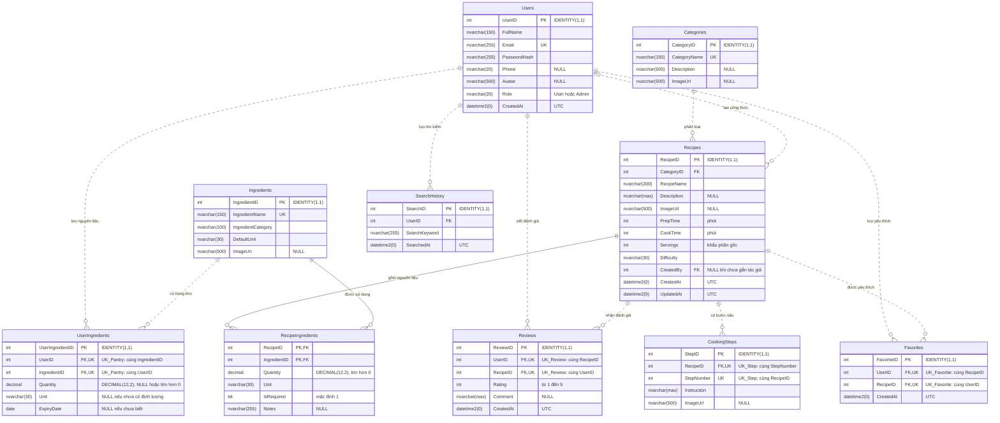

# Sơ đồ quan hệ dữ liệu SmartCook

Cơ sở dữ liệu `SmartCookDB` gồm 10 bảng trong schema `dbo`. Tên bảng và cột trong sơ đồ khớp với [schema.sql](../database/schema.sql). Chi tiết kiểu dữ liệu, giá trị mặc định và ràng buộc được giải thích trong [DATABASE_DESIGN.md](DATABASE_DESIGN.md).

`PK` là khóa chính, `FK` là khóa ngoại và `UK` là khóa duy nhất. Khi hai cột cùng ghi một tên nhóm `UK`, tính duy nhất áp dụng cho **cặp cột**, không áp dụng riêng từng cột. Cú pháp sơ đồ theo [tài liệu Mermaid ER](https://mermaid.js.org/syntax/entityRelationshipDiagram.html).

## Cách đọc quan hệ

| Quan hệ | Ý nghĩa |
| --- | --- |
| `Categories` → `Recipes` | Một danh mục có thể chưa có hoặc có nhiều món; mỗi món bắt buộc thuộc một danh mục. |
| `Users` → `Recipes.CreatedBy` | Một người có thể tạo nhiều món; một món có thể chưa gắn tác giả hoặc có đúng một tác giả. Seed dùng `CreatedBy = NULL`, không tạo tài khoản mẫu. |
| `Recipes` ↔ `Ingredients` | Quan hệ nhiều–nhiều qua `RecipeIngredients`, khóa chính `(RecipeID, IngredientID)`; mỗi nguyên liệu xuất hiện tối đa một lần trong một công thức. |
| `Recipes` → `CookingSteps` | Một món có nhiều bước. Cặp `(RecipeID, StepNumber)` là duy nhất; số bước phải lớn hơn 0. |
| `Users` ↔ `Recipes` qua `Favorites` | Một người lưu một món tối đa một lần. |
| `Users` ↔ `Recipes` qua `Reviews` | Một người có tối đa một đánh giá cho mỗi món; lần đánh giá tiếp theo cần cập nhật dòng hiện có. |
| `Users` ↔ `Ingredients` qua `UserIngredients` | Một dòng tổng hợp cho mỗi cặp người dùng–nguyên liệu; chưa mô hình hóa nhiều lô hoặc nhiều hạn dùng cho cùng nguyên liệu. |
| `Users` → `SearchHistory` | Một người có thể có nhiều lần tìm kiếm. Khách vẫn tìm kiếm được nhưng bảng này chỉ lưu lịch sử gắn với tài khoản. |

Các nhánh con có thể chứa 0 dòng tại mức ràng buộc SQL; FK không bắt buộc một công thức đã có đủ thành phần hoặc đủ bước nấu. Seed và quy trình lưu công thức ở tầng ứng dụng phải kiểm tra tính đầy đủ này. Seed cung cấp đúng 4 bước cho mỗi món, đáp ứng yêu cầu 3–6 bước; SQL không áp giới hạn 6 bước cho dữ liệu tương lai.

Tất cả FK dùng `ON DELETE NO ACTION` và `ON UPDATE NO ACTION`. Quan hệ trên sơ đồ không hàm ý tự động xóa. Nếu một dòng đang được tham chiếu, SQL Server chặn xóa/cập nhật khóa; luồng quản trị ở giai đoạn sau cần xử lý các dòng phụ thuộc hoặc gỡ tác giả trước trong một transaction đã kiểm tra quyền.

Sơ đồ mô tả mô hình thiết kế; kết quả thực thi trên SQL Server và cách chạy lại script xem [hướng dẫn database](../database/README.md).
